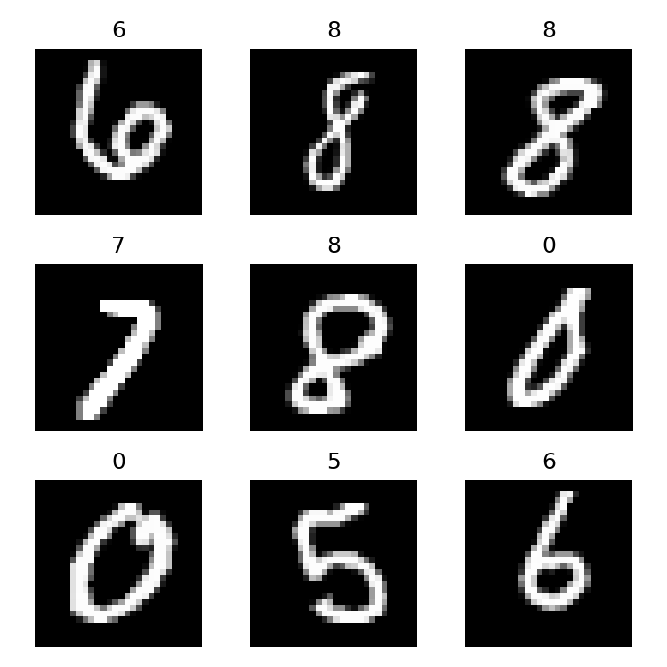
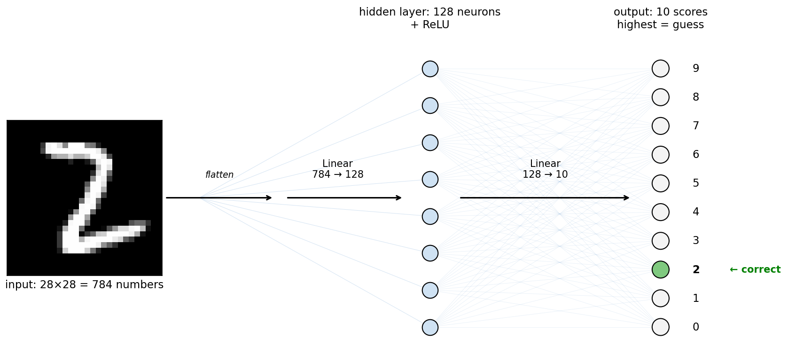
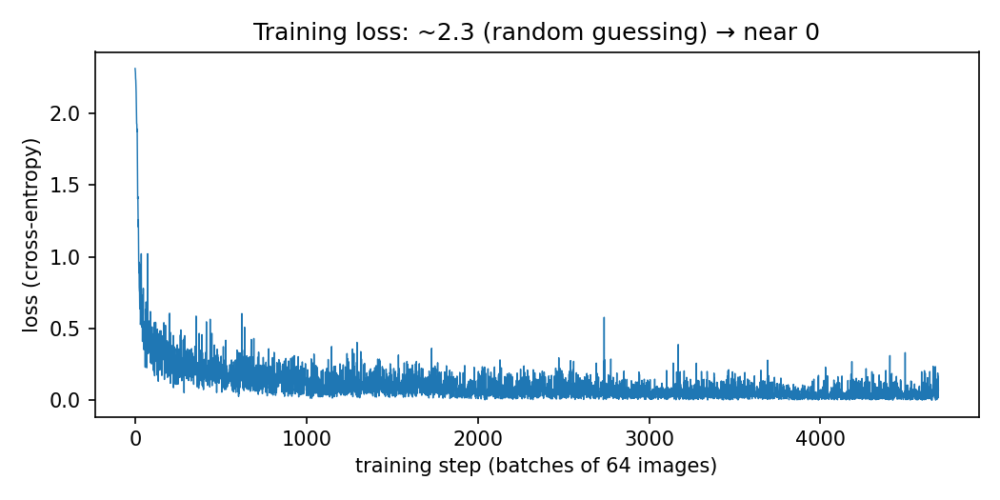
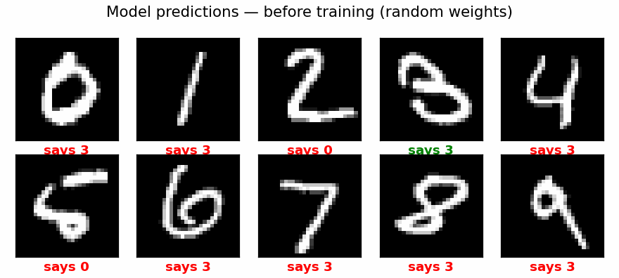
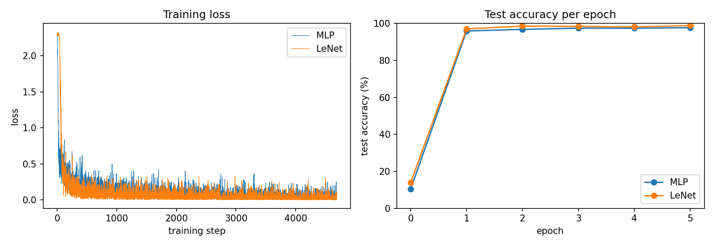

In this tutorial you will set up a clean Python environment, install PyTorch, and train a neural network to recognise handwritten digits from the MNIST dataset - the "hello world" of deep learning. Everything is explained as we go; no prior machine learning knowledge is assumed, only basic [Python](https://learnxinyminutes.com/python/).

**What you'll end up with:** a model that looks at a 28×28 greyscale image of a handwritten digit and tells you which digit (0–9) it is, with ~98% accuracy, trained in a couple of minutes on your CPU.

## 1. The big picture
Before touching any code, it helps to know what "training" actually means.

A **neural network** is a function with millions (billions, or even trillions!) of adjustable dials called **weights**. Initially the dials are set to random values, so the function outputs garbage. Training is an automatic dial-adjusting procedure:

1. Show the network an input (in this case, an image - e.g. a handwritten "7").
2. It makes a guess (probably wrong at first - it's random).
3. A **loss function** measures *how* wrong the guess was, as a single number.
4. **Backpropagation** works out which way to turn each dial to make the loss
   slightly smaller (this is just the chain rule from calculus, applied a
   million times).
5. An **optimiser** nudges every dial a tiny step in that direction. The step
   size is called the **learning rate**.
6. Repeat with thousands of images. The loss drops, the guesses (hopefully) get good.


## 2. Setup: Python, venv, and PyTorch
### Create and activate the venv
You need Python 3.9 or newer (`python3 --version` to check). Then, in a fresh project folder:

```bash
# Create the environment (a folder called .venv)
python3 -m venv .venv

# Activate it - macOS/Linux:
source .venv/bin/activate

# Activate it - Windows (Command Prompt):
.venv\Scripts\activate.bat
# or Windows (PowerShell):
.venv\Scripts\Activate.ps1
```

Your shell prompt should now start with `(.venv)`. From now on, `python` and `pip` refer to the isolated copies. To leave the environment later, run `deactivate`. To come back, `source .venv/bin/activate` again.

### Install PyTorch
```bash
pip install torch torchvision matplotlib
```

- **torch** - the core PyTorch library: tensors (multi-dimensional arrays) plus the automatic differentiation engine that does backpropagation for us.
- **torchvision** - companion library with ready-made datasets (including MNIST) and image utilities.
- **matplotlib** - for plotting a few images so we can *see* the data.

> **Note:** this installs the CPU version of PyTorch, which is all you need here - MNIST is tiny. If you later work on bigger models with an NVIDIA GPU, you'd install a CUDA-enabled build from [pytorch.org](https://pytorch.org).

Sanity check:
```bash
python -c "import torch; print(torch.__version__)"
```

If a version number prints, you're set.

## 3. The code, piece by piece
Create a file called `train_mnist.py`. We'll build it up in sections, and the full listing is at the end. (Or: read the explanations, then just run the full listing.)

### 3.1 The data

```python
from torchvision import datasets, transforms
from torch.utils.data import DataLoader

transform = transforms.ToTensor()

train_data = datasets.MNIST(root="data", train=True,  download=True, transform=transform)
test_data  = datasets.MNIST(root="data", train=False, download=True, transform=transform)

train_loader = DataLoader(train_data, batch_size=64, shuffle=True)
test_loader  = DataLoader(test_data,  batch_size=1000)
```

- **MNIST** is 70,000 greyscale images of handwritten digits: 60,000 for training, 10,000 held back for testing. `download=True` fetches it on first run.
- Keeping a **test set** the model never trains on is essential: it's how we measure whether the model learned *general patterns* rather than memorising its homework.
- `transforms.ToTensor()` converts each image from a PIL image (pixels 0–255) into a PyTorch **tensor** of shape `[1, 28, 28]` with values scaled to 0.0–1.0. Neural nets want numbers, not image files.
- A **DataLoader** feeds data to the model in **batches** of 64 images rather than one at a time. Batching is much faster (matrix operations love bulk) and makes training less noisy. `shuffle=True` randomises the order each pass so the model doesn't learn anything spurious from the ordering.

Want to see the data? This snippet saves a plot of the first 9 examples:

```python
import matplotlib.pyplot as plt

images, labels = next(iter(train_loader))
fig, axes = plt.subplots(3, 3)
for ax, img, label in zip(axes.flat, images, labels):
    ax.imshow(img.squeeze(), cmap="gray")
    ax.set_title(label.item()); ax.axis("off")
plt.savefig("mnist_examples.png")
```



### 3.2 The model
```python
import torch.nn as nn

model = nn.Sequential(
    nn.Flatten(),          # [1, 28, 28] -> [784]
    nn.Linear(784, 128),   # fully-connected layer
    nn.ReLU(),             # non-linearity
    nn.Linear(128, 10),    # one output score per digit 0-9
)
```

This is a small **fully-connected** (a.k.a. MLP) network:



- `nn.Flatten()` - an image is a 28×28 grid, but a plain linear layer wants a flat vector, so we unroll it into 784 numbers.
- `nn.Linear(784, 128)` - a classic matrix multiply plus bias: `y = Wx + b`. It has 784×128 + 128 = 100,480 weights. These are the "dials". Each of the 128 outputs can learn to detect some pattern in the pixels.
- `nn.ReLU()` - sets negative values to zero (`max(0, x)`). Without a **non-linearity** between layers, stacking linear layers is pointless - two matrix multiplies in a row collapse into one. ReLU is what lets the network learn curved, complicated decision boundaries.
- `nn.Linear(128, 10)` - maps down to 10 raw scores (**logits**), one per digit. The highest score is the model's guess. (Use a softmax function to turn logits into probabilities).

### 3.3 Loss and optimiser
```python
loss_fn = nn.CrossEntropyLoss()
optimiser = torch.optim.SGD(model.parameters(), lr=0.05, momentum=0.9)
```

- `CrossEntropyLoss` turns the 10 logits into probabilities and penalises the model based on how little probability it gave the *correct* digit. Confident and wrong → big loss. Confident and right → tiny loss.
- `SGD` (**stochastic gradient descent**) is the optimiser - the dial-nudging step from section 1 made literal. Each weight moves a small step opposite its gradient, scaled by the **learning rate** (`lr=0.05`). "Stochastic" because each step uses a random batch of 64 images, not the whole dataset.
- `momentum=0.9` - each update keeps 90% of the *previous* update's direction, like a ball rolling downhill: it smooths out zigzagging and builds up speed along consistent slopes, so SGD converges much faster. These two values (`lr=0.05`, `momentum=0.9`) are standard starting points.

Watch out for the learning rate in the exercises below: too high and training oscillates or explodes; too low and it crawls. There's a popular, more forgiving alternative to SGD called **Adam** - exercise 6 has you compare them.

### 3.4 The training loop

This is the heart of it - five lines that are the same in nearly every PyTorch project you'll ever see:

```python
for epoch in range(5):                     # 5 passes over the whole dataset
    for images, labels in train_loader:    # 64 images at a time
        optimiser.zero_grad()              # 1. clear old gradients
        logits = model(images)             # 2. forward pass
        loss = loss_fn(logits, labels)     # 3. how wrong were we?
        loss.backward()                    # 4. compute gradients
        optimiser.step()                   # 5. nudge the weights
    print(f"epoch {epoch+1} done, last batch loss: {loss.item():.4f}")
```

One pass through all 60,000 images is an **epoch**. Step 4 is where PyTorch earns its keep: `loss.backward()` automatically computes the gradient of the loss with respect to every single weight - no manual calculus required. Step 5 uses those gradients to update the weights.

Watch the printed loss: it should fall from ~2.3 (random guessing: ln(10) ≈ 2.3) to well under 0.1. That number going down *is* learning.



### 3.5 Did it actually learn? Evaluation
```python
model.eval()  # tell the model we're testing, not training

correct = 0
with torch.no_grad():                      # don't track gradients here
    for images, labels in test_loader:
        predictions = model(images).argmax(dim=1)  # index of max score
        correct += (predictions == labels).sum().item()

print(f"Test accuracy: {correct / len(test_data):.1%}")
```

We run the model over the 10,000 images it has **never seen**, take the highest-scoring digit as its prediction (`argmax`), and count correct answers. `torch.no_grad()` disables the gradient bookkeeping, saving time and memory. Expect **~97–98%**.

Here is the same model, frame by frame, learning to classify ten test digits it never trained on (green = correct, red = wrong):



## 4. Run it

```bash
python train_mnist.py
```

First run downloads MNIST (~10 MB) into `data/`, then trains for 5 epochs - a couple of minutes on a laptop CPU.

## 5. Full listing
```python
import torch
import torch.nn as nn
from torchvision import datasets, transforms
from torch.utils.data import DataLoader

# --- Data ---
transform = transforms.ToTensor()
train_data = datasets.MNIST(root="data", train=True,  download=True, transform=transform)
test_data  = datasets.MNIST(root="data", train=False, download=True, transform=transform)
train_loader = DataLoader(train_data, batch_size=64, shuffle=True)
test_loader  = DataLoader(test_data,  batch_size=1000)

# --- Model ---
model = nn.Sequential(
    nn.Flatten(),
    nn.Linear(784, 128),
    nn.ReLU(),
    nn.Linear(128, 10),
)

loss_fn = nn.CrossEntropyLoss()
optimiser = torch.optim.SGD(model.parameters(), lr=0.05, momentum=0.9)

# --- Train ---
for epoch in range(5):
    for images, labels in train_loader:
        optimiser.zero_grad()
        logits = model(images)
        loss = loss_fn(logits, labels)
        loss.backward()
        optimiser.step()
    print(f"epoch {epoch+1} done, last batch loss: {loss.item():.4f}")

# --- Evaluate ---
model.eval()
correct = 0
with torch.no_grad():
    for images, labels in test_loader:
        predictions = model(images).argmax(dim=1)
        correct += (predictions == labels).sum().item()
print(f"Test accuracy: {correct / len(test_data):.1%}")

# --- Save ---
torch.save(model.state_dict(), "mnist_model.pt")
```

The last line saves the trained weights to `mnist_model.pt`, so you can reload them later (`model.load_state_dict(torch.load("mnist_model.pt"))`) without retraining.

## 6. Things to try
The fastest way to build intuition is to break things on purpose:
1. **Remove the ReLU.** What happens to accuracy? Why?
2. **Change the learning rate** to `1e-1`, then `1e-5`. What changes?
3. **Make the hidden layer bigger** (128 → 512) or add another `Linear`/`ReLU` pair. Does it help?
4. **Train for 1 epoch instead of 5.** Where's the trade-off?
5. **Look at its mistakes:** collect test images where the model was wrong and plot them. Would *you* have got them right?
6. **Switch optimisers.** Replace the SGD line with `torch.optim.Adam(model.parameters(), lr=1e-3)` and rerun, noting test accuracy after each epoch. Adam adapts the step size for every weight individually, so it works well with almost no tuning - expect ~94% after one epoch, ~97% after five. But compare honestly with what you just got from tuned SGD (~96% after one, ~98% after five): on this simple problem SGD actually edges it out. The real lesson: Adam's advantage is needing *less tuning*, which is why it's the modern default - not that it's magically better. On big models with messy loss surfaces, that tuning-free robustness matters much more than it does here.

## 7. Where next?
- This model ignores the *spatial* structure of images (it flattens them). Convolutional networks (`nn.Conv2d`) exploit that structure - see the extension in section 8 below.
- The official PyTorch tutorials at [pytorch.org/tutorials](https://pytorch.org/tutorials/) pick up exactly where this leaves off.

## 8. Extension: a convolutional network (LeNet)

Our MLP flattens each image into 784 unrelated numbers - it has no idea that two neighbouring pixels form an edge, or that a "7" is a "7" whether it's centred or shifted two pixels left. A **convolutional neural network (CNN)** builds that knowledge in.

**LeNet-5** (LeCun et al., 1998) is the original CNN, designed for exactly this digit-recognition task. It introduces two layer types:

- **`nn.Conv2d`** - instead of connecting every pixel to every neuron, a small **kernel** (here 5×5) slides across the image, detecting the *same pattern* everywhere: a horizontal edge is a horizontal edge wherever it appears. Each kernel produces a **feature map** highlighting where its pattern occurs. The first conv learns 6 such detectors, the second 16 (looking for combinations of the first layer's edges - curves, corners, loops).
- **`nn.MaxPool2d(2)`** - shrinks each feature map by taking the max of every 2×2 block. This halves the resolution (cheap) and makes detection slightly tolerant to small shifts: roughly *where* the edge was matters less than *that* it was found.

```python
lenet = nn.Sequential(
    nn.Conv2d(1, 6, kernel_size=5), nn.ReLU(), nn.MaxPool2d(2),   # 28→24→12
    nn.Conv2d(6, 16, kernel_size=5), nn.ReLU(), nn.MaxPool2d(2),  # 12→8→4
    nn.Flatten(),
    nn.Linear(16 * 4 * 4, 120), nn.ReLU(),
    nn.Linear(120, 84), nn.ReLU(),
    nn.Linear(84, 10),
)
```

Note the shape bookkeeping in the comments: a 5×5 kernel on a 28×28 image produces 24×24 (it can't centre on the outer 2 pixels), then pooling halves it to 12×12, and so on - ending with 16 maps of 4×4, flattened to 256 numbers for the classifier part. Everything else - data, loss, optimiser, training loop - is *identical* to before. Swap the model definition and rerun.

### Does it help?

Both models trained for 5 epochs, same settings, on the same machine:



| Model | Test accuracy | Parameters | Training time (CPU) |
|-------|--------------|------------|---------------------|
| MLP   | 97.8%        | 101,770    | ~6 s                |
| LeNet | **98.9%**    | **44,426** | ~28 s               |

Three takeaways:

1. **LeNet is more accurate with less than half the parameters.** Exploiting image structure means it needs fewer dials to do a better job - weight sharing (one kernel reused everywhere) is very parameter-efficient.
2. **It's slower per step.** Convolutions are more arithmetic than a matrix multiply, and on a CPU you feel it. (On a GPU this gap shrinks dramatically - convolutions parallelise beautifully.)
3. **The gap looks small because MNIST is easy.** 97.8% vs 98.9% is ~110 fewer misclassified digits out of 10,000 - meaningful, but not dramatic. On harder, real-world images the MLP plateaus quickly while CNNs keep climbing; that difference is why CNNs took over computer vision.

To see its mistakes for yourself, reuse exercise 5 from section 6 with `lenet` - you'll find the remaining errors are mostly digits even humans would squint at.

## 9. Extension: standing on giants' shoulders — fine-tuning a pretrained ResNet

So far we've trained every weight from random initialisation. In practice, nobody does this unless they have to: you download a network someone else trained for weeks on a giant dataset, and **fine-tune** it for your problem. This is called **transfer learning**, and it's how most real-world deep learning gets done.

### ResNet and residual connections, in one paragraph

**ResNet** (He et al., 2015) is the architecture that made very deep networks trainable. Stacking more layers *should* help, but past a certain depth training got *worse* — gradients degrading as they pass through dozens of layers. ResNet's fix is the **residual (skip) connection**: each block computes `output = F(x) + x` — the layer learns only a *correction* to its input rather than a whole new transformation, and gradients can flow backwards through the `+ x` shortcut untouched. That one trick enabled networks 100+ layers deep and won the ImageNet competition in 2015. We'll use **ResNet-18** (18 layers, ~11 million parameters) — small by modern standards, huge next to our LeNet.

### The fine-tuning recipe

**Step 1 — load it pretrained.** `weights="DEFAULT"` downloads weights trained on ImageNet: 1.2 million photographs across 1,000 classes. Its early layers already detect edges, textures and shapes — features any vision task can reuse.

```python
from torchvision import models

model = models.resnet18(weights="DEFAULT")   # ~45 MB download, once
```

**Step 2 — replace the head.** The last layer outputs 1,000 ImageNet class scores. We don't care about those classes — chop it off and attach a fresh, randomly-initialised layer for our 10 digits:

```python
model.fc = nn.Linear(model.fc.in_features, 10)
```

**Step 3 — adapt the inputs.** The pretrained network expects 3-channel images, roughly photo-sized, scaled the way ImageNet images were scaled (these magic numbers are ImageNet's channel means and standard deviations):

```python
transform = transforms.Compose([
    transforms.Resize(64),        # 28×28 is tiny for a deep network
    transforms.Grayscale(3),      # copy the one channel into three
    transforms.ToTensor(),
    transforms.Normalize(mean=[0.485, 0.456, 0.406],
                         std=[0.229, 0.224, 0.225]),
])
```

**Step 4 — train the head only (backbone frozen).** Freezing means `requires_grad = False`: no gradients, no updates — the pretrained features stay put, and only our 5,130 new head weights learn. This is fast and safe.

```python
for p in model.parameters():
    p.requires_grad = False          # freeze the backbone
for p in model.fc.parameters():
    p.requires_grad = True           # ...except the new head

optimiser = torch.optim.SGD(model.fc.parameters(), lr=0.05, momentum=0.9)
# ... same training loop as before ...
```

**Step 5 — unfreeze and fine-tune gently.** Now let the whole network adjust, but with a **much smaller learning rate** (0.005, not 0.05): the pretrained weights are already good, and big steps would wreck them. One epoch is enough to see the effect.

```python
for p in model.parameters():
    p.requires_grad = True
optimiser = torch.optim.SGD(model.parameters(), lr=0.005, momentum=0.9)
# ... same training loop again ...
```

### What actually happens

Run on a 12,000-image training subset (to keep CPU time in minutes rather than hours), test accuracy after each stage:

| Model | Test accuracy | Parameters | Cost |
|-------|--------------|------------|------|
| MLP (§3) | 97.8% | 101,770 | ~6 s total |
| LeNet (§8) | **98.9%** | 44,426 | ~28 s total |
| ResNet-18, head only (frozen) | 82.7% | 11.2M (5,130 trained) | ~50 s/epoch |
| ResNet-18, fully fine-tuned (1 epoch) | 97.7% | 11.2M | ~18 min |

Three lessons, and the first one surprises most people:

1. **Pretrained ≠ instantly good.** With the backbone frozen, accuracy stalls around 80% — *worse than our MLP*. ImageNet is photographs of objects; MNIST is white pen strokes on black. The pretrained features detect fur, wheels and textures — not strokes. Transfer works best when the original and new tasks are *similar*; here the **domain gap** is real.
2. **Unfreezing closes the gap fast.** One gentle epoch of full fine-tuning jumps from 83% to 97.7%: the early layers re-specialise from photo textures to strokes. More epochs would keep it climbing — at ~18 minutes per epoch on CPU. (This is exactly where a GPU pays for itself: same code, ~50× faster.)
3. **Use the right tool.** For MNIST, from-scratch LeNet beats a fine-tuned ResNet at 1/250th of the parameters. The killer application of fine-tuning is the opposite situation: **little data, related domain**. Classifying a few hundred photos of cats vs dogs? A pretrained ResNet hits the high 90s in minutes, where a from-scratch model would flounder. That's why "download pretrained → replace head → fine-tune" is the single most-used recipe in applied deep learning.
